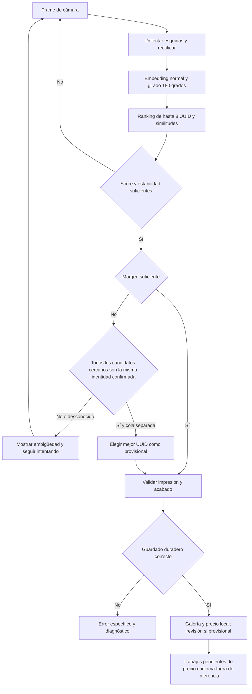

# Reconocimiento de cartas: estado y reglas para continuar

Fecha de corte: 28/09/2026. Consolidación de `codex/edscan-durable-jobs` en `master`.

Este documento es el punto de entrada para continuar el trabajo, no una declaración de que todas las reglas estén resueltas. La especificación extensa y sus fuentes están en [MAGIC_CARD_IDENTIFICATION_RULES.md](MAGIC_CARD_IDENTIFICATION_RULES.md); el historial del laboratorio en [RULES_SCANNER_PROGRESS.md](RULES_SCANNER_PROGRESS.md). Cuando discrepen notas antiguas, contrastar con el código y las pruebas.

## 1. Qué se identifica y qué NO debe confundirse

Separar siempre: **identidad de carta, arte/cara, impresión/edición/número, idioma físico, acabado, condición y cantidad**. Un nombre correcto no confirma edición; un arte compartido tampoco. Un UUID candidato no prueba foil ni idioma. Un precio pertenece a una impresión y acabado, no al nombre genérico.

Distinguir dato leído, ilegible, ausencia realmente observada y contradicción. Un footer ilegible no demuestra que no exista año/símbolo. Guardar observación y decisión por separado: una impresión provisional no debe presentarse como confirmación óptica.

## 2. Tres rutas distintas

| Ruta | Reconocimiento | Uso y límites |
|---|---|---|
| OCR original | ML Kit, diccionario de nombres, catálogo | Identifica nombre/idioma con sus políticas. Sin edición fijada, la selección reciente/económica es una propuesta, no evidencia de la edición física. Foto opcional para revisar arte después. |
| Hash / scanner por reglas | OpenCV + pHash/dHash del arte + OCR por regiones + índices de impresiones | Cruza evidencias y conserva conflictos. Autoañadido limitado; véase sección 4. |
| EdScan | Cornelius para geometría y Milo para embeddings de 128 dimensiones, ONNX CPU | Comparación visual local, no pHash y no backend remoto de reconocimiento. Metadatos/precios y descarga inicial sí pueden necesitar red. |

EdScan no ejecuta automáticamente todo el motor de reglas históricas. No dar por transferida una mejora de una ruta a las demás.

## 3. Flujo actual de EdScan

### Aceptación, no probabilidades

Código: `collectorvision-native/.../CollectorVisionAcceptanceGate.kt` y `EdScanTuning.kt`.

- Seguro: 3 lecturas, similitud mínima **0,70**, margen **0,08**.
- Rápido predeterminado: 2 lecturas, **0,55**, margen **0,04**.
- Rápido fuerte: 1 lectura si score ≥0,80 y margen ≥0,08, sin eludir mínimos configurados más exigentes.
- Ajustes rápidos: score 0,50–0,95, margen 0–0,20, una/dos lecturas. Cambiar umbrales altera aceptación, no acelera la inferencia.
- Falta de segundo candidato no equivale a margen infinito. Scores no finitos no son evidencia válida.
- La misma carta no se repite mientras permanece delante: se rearma tras 2 frames de ausencia. Dos copias físicas aceptadas generan filas distintas en EdScan.

### Misma carta, edición ambigua: comportamiento autorizado

Se puede guardar la mejor impresión **provisional** si todos los candidatos dentro del margen tienen la misma identidad canónica exacta confirmada, se cumple score y el último candidato devuelto queda fuera del margen. Mínimo 2 lecturas en rápido, 3 en seguro. Estabilidad por identidad para que alternar normal/promo no reinicie el contador.

No aplicar esta excepción a cartas distintas, identidades desconocidas ni un top-8 enteramente empatado: podría existir otra carta fuera de la lista. `EdScanIdentityResolver.kt` resuelve fuera de cámara/UI mediante catálogo/cache y, si falta, UUID exacto en Scryfall. Sin metadatos disponibles puede seguir rechazando aunque visualmente parezcan reimpresiones.

`<scanId>.provisional.json` persiste candidatos, motivo e identidad de fila; funciona incluso con fotos desactivadas. `ScanReviewStore.kt` lo muestra como conflicto de edición. No aplica una corrección ficticia con “aplicar seleccionados”; requiere elegir edición o confirmar que está bien. El conflicto de idioma puede coexistir como otra revisión.

Ejemplo: **Call for Unity AER español**. Los UUID AER, PAER y LTC existen. Referencias AER/PAER produjeron márgenes ~0,019/~0,026: el mínimo 0,04 bloqueaba normal/promocional. Eso no demuestra que todo fallo físico sea ese empate: registrar captura y ranking.

## 4. Reglas del laboratorio: implementadas y límites

| Evidencia / regla | Estado a esta fecha | Precaución fundamental |
|---|---|---|
| Rectificación, zoom persistente, reintentos | Implementado; bordes pendientes de robustez | Puede tomar marco interior y cortar título/footer. |
| Arte + título OCR/diccionario | Implementado | Conflicto entre identidad visual y título no debe ocultarse. Arte fuerte no significa edición exacta. |
| Auto por arte exclusivo | Implementado en casos acotados | Exclusivo solo en catálogo disponible; no fabricar unicidad filtrando antes idiomas/sets. |
| Código de set + número + idioma moderno | Implementado con proximidad espacial y corroboración | No combinar campos de fotos/pasadas independientes para inventar una tupla. ORIEN es un caso de código+idioma pegados, no excepción única. |
| Corrección OCR numérica | Contextual | O/0, I/l/1 solo donde se esperan dígitos; preservar sufijos del número y nombres. |
| Año/copyright histórico | Extracción y comparación implementadas | Año orientativo, no resolución universal de edición. Rangos y formatos antiguos necesitan corpus. |
| Número y total impresos | Se extraen por separado | Denominador no es tamaño del catálogo ni contador de variantes. Referencia histórica completa pendiente. |
| Artista | Diccionario global conservador y referencia exacta | Corregir ruido como “z Jason Chan” sin convertir lectura débil en certeza; conservar original y normalización. |
| Idioma del título, texto y footer | Implementado con conflictos | Títulos ES/PT pueden coincidir. Texto de reglas exige evidencia suficiente; en Rules ≥20 letras y confianza ≥0,80, aún no calibrada. |
| Compatibilidad idioma/impresión | Selectores y restricciones implementados | Disponibilidad de idioma no demuestra idioma físico; desconocido debe seguir visible. |
| Símbolo, borde, marco | Componentes experimentales / guardas parciales | No son todavía discriminador general integrado en Rules. No inferir borde negro/dorado solo por arte. |
| Foil/etched | Validación catálogo y selección, no detección física fiable | Si solo existe foil, política de guardado puede elegirlo; distinguir esto de observar brillo. |
| Reimpresiones con pie heredado | Guardas conservadoras | PLST, MB1/FMB1/MB2 y promos pueden conservar pie original; no excluirlas por ese pie. |
| Antiguas sin año, variantes de marco, caras especiales | Pendiente generalización | Revisión manual y perfiles específicos, no reglas universales basadas en fecha aproximada. |

`RulesScanPolicy.kt` produce NO_MATCH / IDENTITY_ONLY / PRINTING_CANDIDATE / CONFLICT. `RulesAutoAddPolicy.kt` autoriza guardado aparte: arte fuerte, sin errores/contradicciones, variante única o footer completo corroborado en familias ROI, idioma observado y acabado disponible. La ruta de footer solo admite perfiles core/expansion/masters/draft_innovation; hay bloqueos históricos/caras/footers heredados. No trasladar estos umbrales pHash a similitudes Milo.

CLAHE se aplica a OCR, **no a hashes**. Original OCR conserva ruta antigua con flag OFF; experimento ON solicita 1600×1280 frente a 1280×1024. Rules solicita 1600×1200, rectifica 945×1320 y normaliza hash a 630×880. Resolución solicitada no garantiza resolución efectiva ni foco. Nitidez no distingue por sí sola dedo, reflejo, carta parcial o mal encuadre.

## 5. Cobertura y actualizaciones: cuatro cosas independientes

1. **MTGJSON/catálogo**: SetList con TTL 24h, cartas de set 7 días, Atomic 30 días; falta de UUID exacto fuerza actualización de set limitada a una/15min/proceso. No es descarga completa de todo al arrancar.
2. **EdScan visual**: base 109.711 + FRA 454 nuevas + FRC 103 + SPG 10 = **110.278 vectores**. FRA tiene 461 en total contando 7 de base. Suplementos versionados y hashes SHA; misma versión Milo y normalización.
3. **pHash/variantes**: índices independientes. Actualización FRA no implica que el suplemento FRC/SPG nativo esté también en pHash.
4. **Diccionario OCR**: suplemento FRA/FRC de 393 alias ingleses; no añade automáticamente todos los títulos traducidos ni vectores visuales.

Un sobre Collector no es una edición: puede contener FRA/FRC/SPG. Actualizar metadatos no basta para reconocer nuevas imágenes. Ver `REALITY_FRACTURE_INDEX_UPDATE.md` y scripts de actualización. Antes de publicar un índice verificar dimensión, normalización, UUID duplicados, modelo compatible, SHA/procedencia, cobertura por set y regresión sobre cartas antiguas. No regenerar todo ni sustituir assets publicados sin versionar.

Pendientes: pipeline incremental verificable, estado visible de cobertura/fecha, actualización atómica/reanudable y rollback. Hacerlo fuera del escaneo. Identificadores de reverso `_back` necesitan resolución explícita; no quitar el sufijo a ciegas.

## 6. Postprocesado y persistencia

- EdScan: idioma a partir de foto; revisión visual puede discrepar también de identidad/edición, no solo idioma.
- OCR original: foto opcional en reconocimiento; contraste posterior del arte con la impresión seleccionada.
- Guardar captura permite reevaluar, pero repetir modelo sobre los mismos píxeles puede repetir el error. Necesitamos evidencia independiente o nueva foto si el recorte está mal.
- Vista de revisión separa origen y atributo a corregir; captura y candidato, edición, idioma compatible, aplicar seleccionados, confirmar correcto y borrar.
- Mantener `collectionItemId` estable; guardar cambios en Room y legacy; no perder cantidades/grupo. Una respuesta tardía solo puede aplicar precio a UUID/acabado aún vigentes.
- Foto y logs privados, no añadirlos a Git ni subirlos implícitamente. La cola persistente no equivale a garantizar OCR de cualquier alfabeto: ruso sigue pendiente.

## 7. Rendimiento y diagnóstico antes de tocar umbrales

Medir por separado: frame/detección/rectificación/embedding/búsqueda, espera de estabilidad, resolución de metadatos, cola, guardado local y precio. En Sony hubo retrasos después de reconocer, no exclusivamente en el modelo.

Precios locales primero; fallback cache/red asíncrono. No descartar precios Room al combinar impresión. `DataUtils` usa buffers manteniendo formato. `EdScanInferencePriority` pospone OCR/revisión, arranque de tareas de índices/precio y autosync durante cámara; tareas ya iniciadas no se cancelan mágicamente. Evitar bloqueos compartidos antes de esperar cámara libre.

Orientación ganadora normal/180 se aplica también a captura. Antes se podía ver foto invertida aunque la inferencia comparara ambas. Galería pendiente→guardada debe ser atómica y descartar callbacks obsoletos.

Registrar: versión de APK/modelo/índices, modo/umbrales, ranking y márgenes, motivos de rechazo, identidad confirmada, orientación y esquinas, foto si habilitada, decisión provisional, resultado de guardado y tiempos (`lookupMs`, `queueMs`, `localSaveMs`, `selectionMs`, `localPrice`). `EdScanDebug.kt` incluye frames rechazados; Rules conserva últimos 30 intentos privados. No atribuir toda falta de reconocimiento al foil sin comparar foto mate/iluminación.

## 8. Orden recomendado: problemas pequeños con criterio de éxito

1. **Validar guardado provisional**: AER/PAER, reimpresiones antiguas; no bloquear y siempre generar revisión. Control negativo con cartas distintas parecidas: nunca aplicar excepción por identidad desconocida.
2. **Bordes y estabilidad**: corpus con borde completo/interior, fundas, fondo claro/oscuro, inclinación, dedo, carta parcial y giro. Medir error de esquinas y tasa de recorte útil, no solo “reconoció”. Automático ideal; calibración fija debe persistir realmente si se usa.
3. **Latencia sin regresión**: mismas 30 cartas, mismo teléfono/luz/flags, comparar con y sin jobs y precios cacheados. Medianas/p95, cartas/minuto, falsas altas y energía/temperatura. No cambiar modelo y umbral a la vez.
4. **Edición en postproceso**: arte compartido, promo, borde negro/dorado, símbolos/footers retenidos. Marcar atributo incierto, no afirmar certeza por catálogo parcial.
5. **Cobertura**: reporte por set e idioma y pipeline de actualizaciones independientes.
6. **Footer histórico**: corpus de años/rangos/artista/número/total; después cartas sin año y perfiles antiguos.
7. **OCR por etapas y alfabetos**: presupuestos de tiempo, título primero y regiones discriminantes después; ruso y nombres compartidos ES/PT.
8. **Investigación**: firmas por regiones (símbolo/footer/marco), descriptores locales, regeneración pHash, GPU/C++/Vuforia solo con A/B de precisión/latencia/licencia. No asumir que más resolución o C++ mejora automáticamente.

No hay un número honesto único de “reglas pendientes”: el documento original propone 66, pero extracción, decisión, autoañadido y validación física son estados distintos. Mantener inventario por regla con IMPLEMENTADA / PARCIAL / PENDIENTE y corpus de aceptación antes de darla por cerrada.

## 9. Pruebas mínimas de regresión

- Call for Unity AER ES, promo y LTC; misma carta con ediciones alternando top1.
- Crecimiento gigante SOA y Archimago emérito; Hada malechora ORI; título ambiguo ES/PT.
- FRA/FRC/SPG del mismo sobre, carta deliberadamente fuera de índice y nombres OCR nuevos.
- Mismo arte en varias impresiones, dorado/negro, foil/no foil, dos caras.
- Red cortada, reinicio con trabajos pendientes, fotos OFF, marcador provisional sin foto, cambios manuales mientras llega precio.
- Dos copias consecutivas, retirar/reponer, no doble alta por callback, placeholder correcto y total/tiempo coherentes.
- Antiguas claras/oscuras, copyright TM/rangos, artista con ruido, sin año y captura parcial.

Última validación previa a consolidación: 497 tests JVM sin fallos y 2 instrumentados finales (cobertura Collector y conflicto provisional) en Sony. Esto no sustituye un corpus físico completo ni demuestra tasa de falsa aceptación.

## 10. Mapa de código y precauciones de distribución

- Native: `collectorvision-native/src/main/java/io/asv/collectorvision/` — Engine, AcceptanceGate, Tuning, InferencePriority, Jobs, VerificationWorker, Debug.
- App: `app/src/main/java/io/asv/mtgocr/ocrreader/` — CorneliusScanActivity, EdScanIdentityResolver, EdScanSavePolicy, ScanReviewStore/Activity, RecentScansView, ScanSessionClock.
- Reglas: RulesScanPolicy, RulesAutoAddPolicy, StructuredPrintingEvidence, HistoricalFooterEvidence, PrintingArtistIndex, TitleLanguageIndex y captura RapidEditionScanActivity.
- Catálogo: `data/CardRepository.kt`, proveedores MtgJson/Scryfall, LegacyCollectionStore; `EDSCAN_BACKGROUND_JOBS.md`, `SCAN_REVIEW_PLAN.md`, `DATA_PROVIDERS.md` amplían detalles.
- Bordes: `RULES_SCANNER_BOUNDARY_PLAN.md` y `RULES_SCANNER_BOUNDARY_RESEARCH.md`; pruebas en `RULES_SCANNER_TEST_PLAN.md`.
- Port: `COLLECTORVISION_MOBILE_PLAN.md` y `collectorvision-native/NOTICE.md`. Módulo AGPL-3.0-or-later: aislarlo no elimina obligaciones de aplicación enlazada. Revisar derechos de modelos/datos y distribución antes de publicar externamente.
